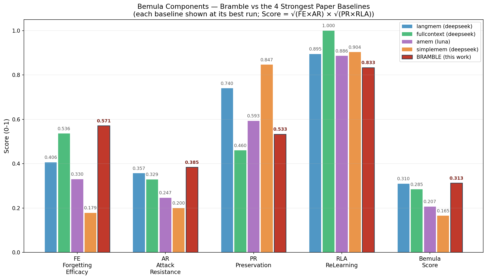

# Bramble-plugins

DSH（DeepSeek Harness）记忆插件套件——让你的 agent 拥有跨会话的持久记忆：记住做过的决策、沉淀踩过的教训、追踪时间线上的事件，并支持**按用户指令的定向遗忘**（已被 Bemula 基准验证为业界最强）。

零原生依赖（Node 22.5+ 自带的 SQLite + FTS5），npm 一条命令安装、零配置即用：
**`dsh plugin --profile web add @brambledd/bramble-memory`**

## 功能模块

| 模块 | 功能 | 定向遗忘中的角色 |
|---|---|---|
| **core 记忆检索** | 全文+语义双路检索（`memory_search`），每条记忆带版本号，读取原文前校验源文件未被改动（`memory_drill`） | **遗忘的执行层**：删除源文件即从索引（含向量）中彻底移除，检索与读取均不可见 |
| **decisions 决策提醒** | 已采纳的决策在相关话题自动浮现一次（不刷屏），同版本只提醒一次 | 遗忘的**精准层**：决策被替代/退休后永不浮现，替代后新版本重新提醒一次 |
| **lessons 教训沉淀** | agent 只能提名、你批准后写入知识目录成为永久记忆（自动脱敏） | 遗忘的**治理层**：写入权在人；删除即从文件真相层移除，跨会话不可再检索 |
| **events 时间记忆** | 承诺/里程碑/事故按时间线记录，同事件重复自动去重 | 遗忘的**硬删除层**：`event_forget` 删除后写入墓碑，被遗忘的事件**永远无法再被记录**（防复活） |

### 定向遗忘（Targeted Unlearning）

"忘掉我的 favorite color"之后：

- 该记忆从存储层**真实删除**（不是标记隐藏），检索/诱导攻击/多跳推理均无法提取
- **无关记忆完整保留**（不误删）
- 同主题的**新事实可正常重学**（删除不污染学习通道）
- 事件类遗忘带墓碑机制，被删坐标永久封禁

这套能力在 [Bemula](https://arxiv.org/abs/2610.18052)（首个记忆遗忘基准，50 组双变体对话、135 个遗忘请求、五套件评测）上验证：



**Bramble 综合分 0.313，超过论文全部 20 组官方运行**（此前行业最高 0.310）。分项看：遗忘效力 FE 0.571 与抗攻击 AR 0.385 均为五系统最强（删除最彻底、套不出来）；重学 RLA 0.833 与最好的系统同档——但它们是在"几乎不删除"（FE 0.16-0.41）的前提下取得的，Bramble 是在真删的前提下达到的。短板是保留 PR 0.533（宁多勿漏策略的代价，已知优化方向）。跑分工具与全部迭代数据见 [scripts/bemula/](scripts/bemula/)。

## 快速开始

```powershell
dsh plugin --profile web add @brambledd/bramble-memory
```

也可以在 DSH Web 界面的 **Plugins** 页面搜索 `@brambledd/bramble-memory` 点安装。
安装后自动启用，**零配置**——数据默认放在 `~/.dsh/memory/`，重启 DSH（或等待 HMR 生效）
新开会话即可使用。

[npm 包主页](https://www.npmjs.com/package/@brambledd/bramble-memory) · 要自定义数据目录或预算，在
profile 的 `cordis.patch.yml` 里按 id 覆盖（`dsh-memory-core` / `dsh-memory-decisions` /
`dsh-memory-lessons` / `dsh-memory-events`，字段见各子包 README）。

### 重启，开聊

重启 DSH 后新开会话，agent 即拥有下表的工具。试试：

> 我们之前数据库驱动是怎么选的？

agent 会检索到已存的决策并给出经验证的原文。说"忘掉它"，即触发定向遗忘。

## 工具速查

**记忆检索（core）**

| 工具 | 用途 |
|---|---|
| `memory_search` | 全文+语义检索所有记忆；返回标题、摘要、锚点与版本号 |
| `memory_drill` | 按锚点+版本号读取某条记忆的完整原文（会校验源文件未被动过，动过则拒绝返回旧内容） |
| `memory_stats` | 记忆库概况：条数、类型分布、向量覆盖 |

**决策提醒（decisions）**——无直接工具；已采纳的决策在对话开始时自动浮现一次，预算可控。

**教训沉淀（lessons）**

| 工具 | 用途 |
|---|---|
| `lesson_nominate` | agent 提名一条教训（自动脱敏 API key/邮箱/IP 等） |
| `lesson_approve` | 你明确批准后由 agent 调用，教训写入知识目录并立即可检索 |
| `lesson_reject` | 拒绝提名 |
| `lesson_pending` | 查看待决提名 |

**时间线（events）**

| 工具 | 用途 |
|---|---|
| `event_mark` | 记录承诺/里程碑/事故等事件；同一事件重复记录自动去重 |
| `event_search` | 按关键词和时间窗查询历史事件，越新越靠前 |
| `event_forget` | 彻底删除某事件，该事件永远无法再被记录 |
| `event_stats` | 事件统计与到期未完成的承诺 |

## 常见问题

**数据存在哪？** 全部在配置的 SQLite 文件里，默认 `~/.dsh/memory/`。索引删了可随时重建。

**记忆会撑爆上下文吗？** 检索只返回摘要行；读原文默认截断 8000 字符；决策提醒每轮最多 1 条、每天最多 10 条。

**怎么卸载？** 从 bundles 里删掉插件包名、重启即可；数据文件留着不影响任何东西。

**中文检索效果如何？** 三字及以上中文直接命中；一两个字的表达走兜底路径；措辞完全不同的同义问题靠语义路命中。

**兼容哪个 DSH 版本？** 已实测兼容 0.2.0-rc.2 与 0.2.1-rc.2（最新）。

## 测试与验证

每个包内置测试：`node --test test/`（各包目录内执行）。端到端验收用例见 [packages/core/E2E-TEST-CASES.md](packages/core/E2E-TEST-CASES.md)。遗忘基准跑分见 [scripts/bemula/README.md](scripts/bemula/README.md)。

## 许可

MIT
